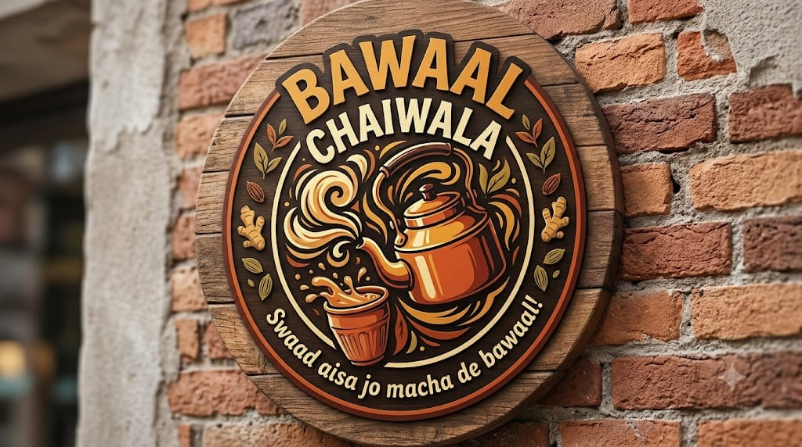

# ☕ Bawaal Chaiwala — Chai Stall Tycoon

<p align="center">
  
</p>

<p align="center">
  <strong>Run your own chai tapri. Make the business calls. Survive the supply shock.</strong>
  <br />
  A browser-based business simulation built for the <strong>VIBESPRINT Hackathon</strong>.
</p>

<p align="center">
  <a href="https://bawaal-chaiwala.samarth-r.dev/"><strong>🚀 Open the Live Project</strong></a>
  &nbsp;·&nbsp;
  <a href="https://github.com/r-samarth/OWASP_EVENT"><strong>View Source Code</strong></a>
</p>

<p align="center">
  
  
  
  
  
</p>

<p align="center">
  <em>“Swaad aisa jo macha de bawaal!”</em>
</p>

---

## ✨ What is Bawaal Chaiwala?

**Bawaal Chaiwala** is an interactive business-management simulation where you run a neighbourhood Indian chai stall. Start with **₹500**, buy ingredients from the wholesale market, choose your menu, set your selling price and serve customers throughout the day.

Every decision has a business impact. Buy too little stock and you lose customers. Price too high and demand can fall. Protect your margins—or protect customer loyalty—when ingredient costs rise unexpectedly.

The experience combines a playful Indian tapri theme with practical concepts from inventory planning, pricing, demand, unit economics and day-to-day business management.

**[Play Bawaal Chaiwala →](https://bawaal-chaiwala.samarth-r.dev/)**

## 🎮 Core features

| Feature | What you can do |
| --- | --- |
| **Business dashboard** | Track your day, available budget, weather forecast and customer rating. |
| **Wholesale inventory** | Buy tea leaves, milk, sugar, spices and earthen kulhad cups. Monitor stock and the ingredient limiting your brewing capacity. |
| **Pricing strategy** | Set a cup price from ₹8 to ₹45. Compare ingredient cost, profit per cup, gross margin and estimated customer demand. |
| **Menu selection** | Choose Bawaal Kadak Chai, Adrak-Elaichi Kulhad or the milk-free Ayurvedic Kadha & Green Tea. |
| **Rush-hour simulation** | Follow morning, afternoon and evening customer rushes, with live sales progress and customer reactions. |
| **Daily profit & loss** | Review revenue, ingredient cost (COGS), daily overhead, net profit, closing budget and customer feedback. |
| **Business history** | Follow your day-by-day performance and cumulative revenue, costs and profit. |
| **Supply-shock challenge** | Respond to a sudden doubling of wholesale milk prices with one of three business strategies. |

## 🌪️ The Minute 40 twist: milk supply shock

The game introduces a sudden supply disruption: wholesale milk increases from **₹60/L to ₹120/L**. You must decide how your business should respond.

| Strategy | Your decision | Main trade-off |
| --- | --- | --- |
| **Raise the price** | Increase the selling price by ₹5 per cup. | Protect per-cup revenue, while risking lower demand from price-sensitive customers. |
| **Absorb the cost** | Keep the current selling price. | Preserve customer goodwill, but accept a lower profit margin as ingredient costs rise. |
| **Pivot the menu** | Switch to Ayurvedic Kadha & Green Tea. | Move to a zero-milk recipe and reduce exposure to the dairy price shock. |

The selected strategy is applied to the game state and carries into the next planning and simulation cycle.

## 🏁 Quick judge walkthrough

The **Judge Demo Bar** at the top of the app provides direct access to the three main evaluation steps.

### Step 01 — Simulate sales
1. Select **STEP 01: Simulate Sales**.
2. Watch the stall progress through its rush-hour shifts.
3. Review cups sold, demand and the impact of available inventory.

### Step 02 — Review the P&L
1. Open **STEP 02: P&L Report** after a sales simulation.
2. Inspect gross revenue, ingredient COGS, daily overhead and net profit.
3. Review the closing budget, customer rating, customer comments and any stockout warning.

### Step 03 — Trigger the milk shock
1. Select **STEP 03: Trigger Milk Shock**.
2. Verify the wholesale milk price change from ₹60/L to ₹120/L.
3. Select and confirm **Raise Price**, **Absorb the Cost** or **Pivot the Menu**.

**Demo tip:** Use the reset control in the Judge Demo Bar before starting a fresh walkthrough. The dashboard also includes a sample-data utility for quickly viewing example reports and a supply-shock scenario.

## 🧮 How the simulation works

The game logic runs in a TypeScript simulation engine in the frontend.

- **Demand:** Estimated demand is affected by the selling price, weather, menu choice and rush-hour conditions.
- **Brewing capacity:** The maximum number of cups is limited by the ingredient in shortest supply for the selected recipe.
- **Sales:** Cups sold cannot exceed customer demand or available brewing capacity.
- **Inventory safety:** The engine deducts only the quantities used and prevents inventory from becoming negative.
- **Daily financials:** Revenue is calculated from cups sold and selling price. Ingredient cost and fixed daily overhead are deducted to calculate net profit.

The core accounting model is:

```text
Gross Revenue = Cups Sold × Selling Price

Net Profit = Gross Revenue − Ingredient COGS − Daily Overhead
```

### Starting conditions

| Setting | Initial value |
| --- | ---: |
| Starting budget | ₹500 |
| Default selling price | ₹15 per cup |
| Daily stall overhead | ₹50 |
| Initial wholesale milk rate | ₹60/L |
| Milk rate after supply shock | ₹120/L |
| Price adjustment option | +₹5 per cup |

The figures, customer personas and market events are part of the simulation. They are not real-time market data or financial advice.

## 🎨 Interface design

The interface uses a warm **espresso, cocoa and caramel** visual system based on a six-colour palette:

| Colour | Hex | Role |
| --- | --- | --- |
| Espresso | `#211713` | Main page background and deepest contrast |
| Deep cocoa | `#493027` | Main dashboard cards, metric panels and modal surfaces |
| Roast brown | `#76503B` | Secondary surface tone and hover/pressed states |
| Caramel | `#A87557` | Visible card outlines, section borders and secondary accents |
| Warm tan | `#D0A98B` | Primary actions, keyboard-focus outlines and highlights |
| Soft cream | `#F0DFCE` | Main text, labels and high-contrast content |

### Border and surface treatment

The interface uses deliberately visible outlines so adjacent panels do not blend into the dark background:

- **Main dashboard sections and modal shells:** solid 2px caramel (`#A87557`) outlines.
- **Nested cards, controls and dividers:** solid 1px caramel outlines.
- **Keyboard focus:** a 2px warm-tan (`#D0A98B`) outline with a 3px offset.
- **Surface hierarchy:** espresso for the page canvas, deep cocoa for primary cards, and roast brown for secondary emphasis.

The layout is responsive and designed to work across desktop, tablet and mobile screens.

## 🧰 Tech stack

| Layer | Technology |
| --- | --- |
| Framework | Next.js 16 App Router |
| UI | React 19 |
| Language | TypeScript |
| Styling | Tailwind CSS v4 |
| Icons | Lucide React |
| Simulation | Client-side TypeScript engine |
| State management | React state |
| Persistence | Browser `localStorage` |
| Hosting | Vercel |

## 🏗️ Architecture

```text
Player
  │
  ▼
Next.js dashboard
  │
  ├── Judge Demo Bar
  ├── Pricing & Menu Strategy
  ├── Inventory & Wholesale Market
  ├── Rush-hour Simulation
  ├── Daily P&L Report
  ├── Milk Supply Shock
  └── Historical Business Ledger
  │
  ▼
Simulation Engine
  │
  ├── Demand and price-sensitivity calculations
  ├── Ingredient capacity and bottleneck calculation
  ├── Inventory deductions and validation
  ├── Revenue, costs and profit calculations
  └── Supply-shock decision handling
  │
  ▼
React Game State
  │
  ▼
Browser localStorage
```

### Browser-first application

The current game frontend does not depend on a running API server or database. The simulation runs in the browser, and game progress is saved in that browser's local storage.

This means:
- No backend deployment is required for the current game experience.
- No API keys or environment variables are required.
- Saved progress belongs to the browser and device where the game is played; it is not synced between devices.
- Clearing the browser's site data can remove the locally saved game progress.

The repository retains an earlier Express + SQLite backend prototype under `backend/`. It is not connected to the current frontend gameplay flow and is not required to run or deploy the game.

## 🚀 Run locally

### Prerequisites

- Node.js **20.9 or newer**
- npm
- A modern web browser

### 1. Clone the repository

```bash
git clone https://github.com/r-samarth/OWASP_EVENT.git
cd OWASP_EVENT
```

### 2. Install frontend dependencies

```bash
cd frontend
npm install
```

### 3. Start the development server

```bash
npm run dev
```

Open [http://localhost:3000](http://localhost:3000) in your browser.

### Available scripts

Run these commands from the `frontend/` directory.

| Command | Purpose |
| --- | --- |
| `npm run dev` | Start the local development server. |
| `npm run build` | Create the production build. |
| `npm run start` | Start the production server after building. |
| `npm run lint` | Run ESLint. |
| `npm run test:verification` | Run the simulation verification scenarios. |

## ☁️ Deployment

The current frontend is deployed on **Vercel**.

**Live URL:** [https://bawaal-chaiwala.samarth-r.dev/](https://bawaal-chaiwala.samarth-r.dev/)

To deploy your own copy:

1. Import the GitHub repository into Vercel.
2. Set the project **Root Directory** to `frontend`.
3. Keep the framework preset as **Next.js**.
4. Use the detected install and build commands (`npm install` and `npm run build`).
5. Deploy.

No backend service or environment variables are needed for the current frontend.

## 📁 Project structure

```text
OWASP_EVENT/
├── README.md
├── AGENTS.md
├── PRD.md
├── ARCHITECTURE.md
├── DECISIONS.md
├── TASKS.md
├── CONTEXT.md
├── docs/
├── backend/                       # Earlier Express + SQLite prototype
└── frontend/
    ├── package.json
    ├── public/
    │   ├── bawaal-logo.jpg
    │   └── bawaal-menu.jpg
    └── src/
        ├── app/
        │   ├── layout.tsx
        │   └── page.tsx            # Main dashboard and game orchestration
        ├── components/             # Dashboard sections and modals
        ├── lib/
        │   ├── constants.ts        # Recipes, prices, inventory and weather
        │   └── simulationEngine.ts # Core game calculations
        ├── types/
        │   └── game.ts             # Game and report types
        └── test-verification.ts   # Core simulation checks
```

## 📚 Project documentation

- [Product Requirements Document](PRD.md)
- [Architecture & System Design](ARCHITECTURE.md)
- [Technical Decisions](DECISIONS.md)
- [Task Breakdown](TASKS.md)
- [Project Context](CONTEXT.md)
- [Agent Guidelines](AGENTS.md)

---

<p align="center">
  <strong>☕ BAWAAL CHAIWALA</strong>
  <br />
  <em>Good chai. Smart decisions. Business that survives the bawaal.</em>
  <br /><br />
  <a href="https://bawaal-chaiwala.samarth-r.dev/">Visit the live project</a>
</p>
