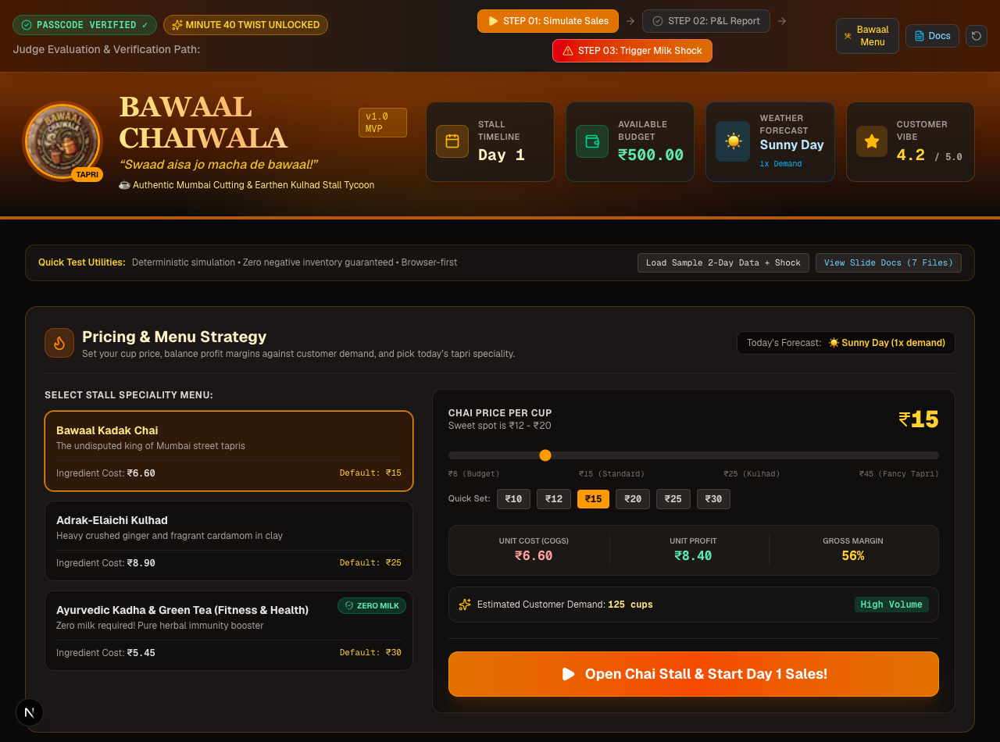
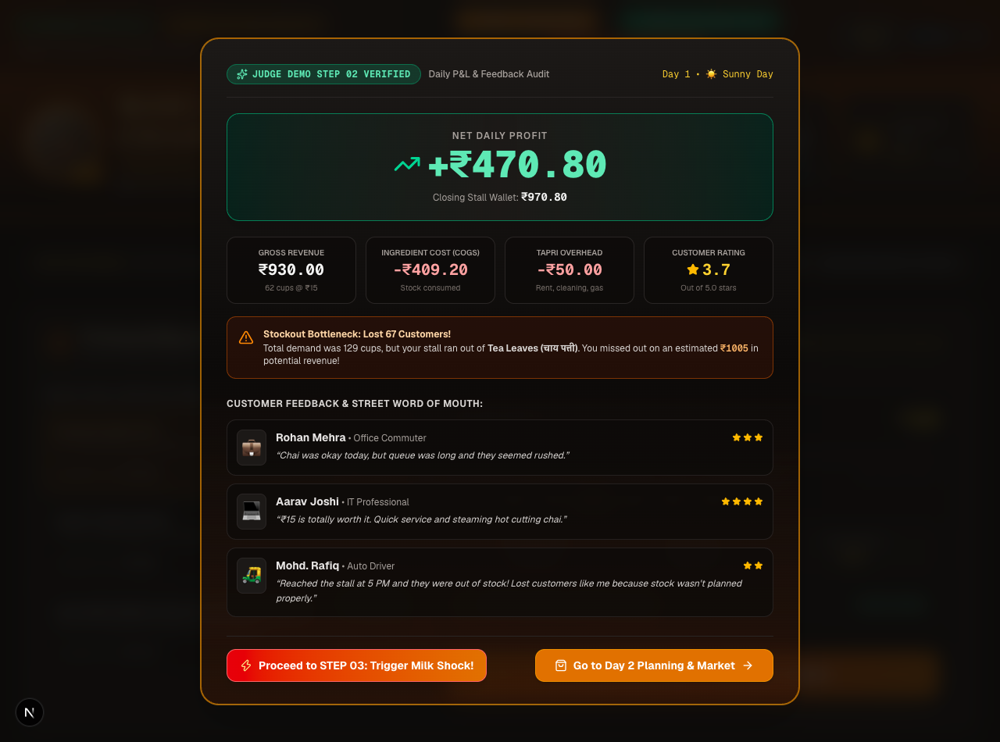
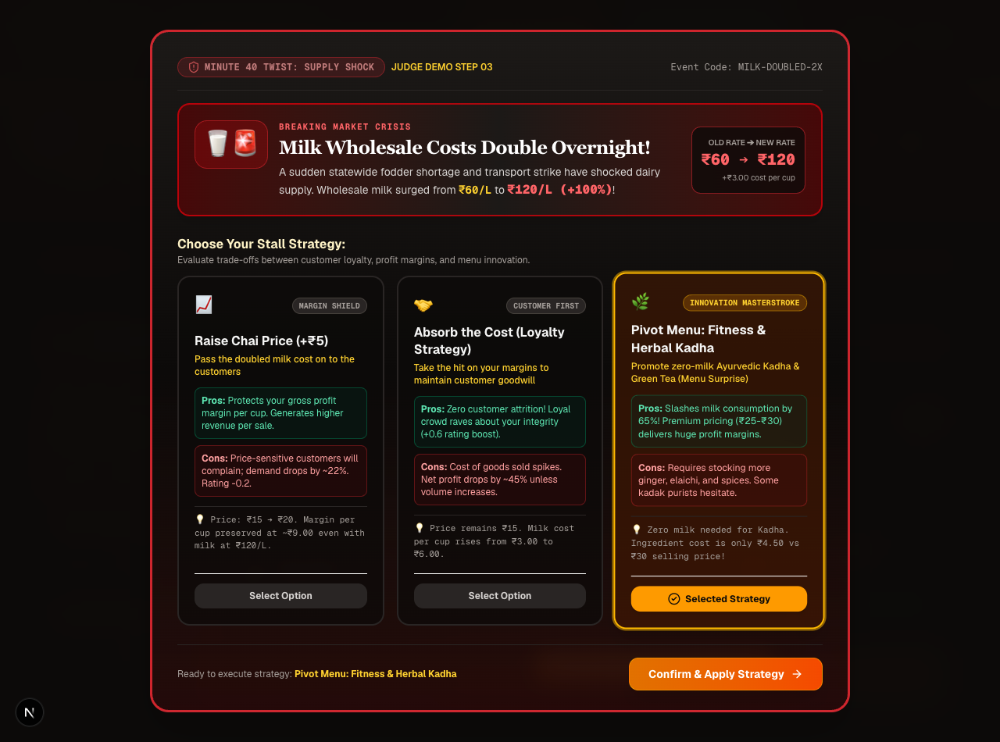
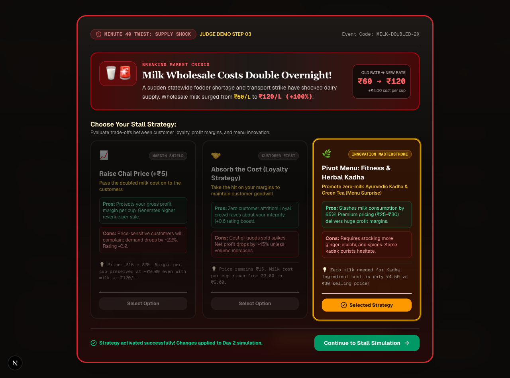
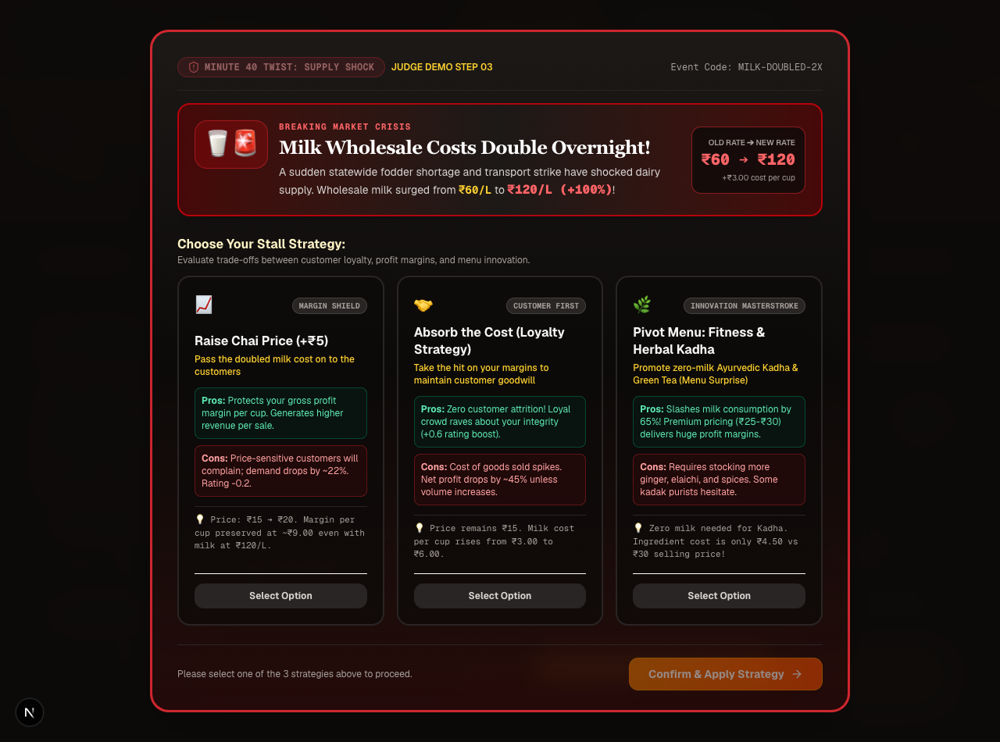

# ☕ Chai Stall Tycoon — Bawaal Chaiwala

<p align="center">
  <strong>Run a neighbourhood chai tapri. Make the business calls. Survive the supply shock.</strong><br />
  A browser-based business simulation built for the <strong>VIBESPRINT Hackathon</strong>.
</p>

<p align="center">
  
  
  
  
  
</p>

<p align="center">
  <em>“Swaad aisa jo macha de bawaal!”</em>
</p>



---

## 🎯 The idea

**Chai Stall Tycoon** turns the everyday economics of an Indian street-side chai stall into an interactive management game. You start with **₹500**, source ingredients, decide what to sell and how much to charge, serve customers through the day's rush, and inspect whether your decisions made the stall profitable.

The central challenge is not just selling more cups. It is balancing **inventory, unit economics, customer expectations, demand and changing ingredient costs**—especially when the price of milk suddenly doubles.

All financial figures and customer personas are fictional simulation data.

## 🕹️ What you can do

| Game mechanic | What it lets you explore |
| --- | --- |
| **Wholesale inventory** | Buy tea leaves, milk, sugar, spices and earthen kulhads. See live stock, affordability and the ingredient limiting your brewing capacity. |
| **Pricing strategy** | Set a cup price from ₹8–₹45, use quick price presets, and compare ingredient cost, profit per cup and gross margin. |
| **Menu selection** | Choose Bawaal Kadak Chai, Adrak-Elaichi Kulhad or the zero-milk Ayurvedic Kadha & Green Tea option. |
| **Demand simulation** | See demand respond to weather, rush-hour intensity, menu choice and price sensitivity across morning, afternoon and evening shifts. |
| **Daily P&L** | Review cups sold, revenue, ingredient cost (COGS), ₹50 daily overhead, net profit and customer feedback. |
| **Business history** | Track day-by-day results, cumulative performance and the impact of decisions. |
| **Supply-shock strategy** | Respond to a 100% increase in wholesale milk cost with one of three business strategies. |

### 🌪️ The Minute 40 twist: milk supply shock

A sudden supply disruption doubles the wholesale milk rate from **₹60/L to ₹120/L**. The player must choose how the business should respond:

| Strategy | Decision | Trade-off |
| --- | --- | --- |
| **Raise the price** | Increase the selling price by ₹5 per cup. | Protect per-cup revenue, while risking lower demand from price-sensitive customers. |
| **Absorb the cost** | Keep the current selling price. | Preserve customer goodwill, but accept a lower margin as ingredient costs rise. |
| **Pivot the menu** | Switch to Ayurvedic Kadha & Green Tea. | Move to a recipe that uses no milk, reducing exposure to the dairy price shock. |

The selected strategy is carried into the next planning and simulation cycle.

## 🏆 Judge walkthrough — the 3-step demo

The sticky **Judge Demo Bar** at the top of the app gives judges direct access to the required evaluation flow.

1. **STEP 01 — Simulate Sales**
   - Click **STEP 01: Simulate Sales**.
   - Watch the stall move through its rush-hour shifts, with animated customer dialogue and live sales progress.
   - The inventory capacity calculation limits cups sold to the stock available.

2. **STEP 02 — Review the P&L**
   - Click **STEP 02: P&L Report** after a simulation.
   - Inspect gross revenue, ingredient COGS, fixed overhead, net profit, closing budget and customer rating.
   - Review generated customer comments and any stockout/lost-demand warning.

3. **STEP 03 — Trigger the Milk Shock**
   - Click **STEP 03: Trigger Milk Shock**.
   - Verify the ₹60/L → ₹120/L price change.
   - Select and confirm **Raise Price**, **Absorb the Cost** or **Pivot the Menu** to apply the strategy.

**Quick demo tip:** Use **Reset** in the Judge Demo Bar before a fresh walkthrough. The dashboard also includes **Load Sample 2-Day Data + Shock** for quickly viewing an example history and report.

## 🧮 The business logic

The simulation is driven by local TypeScript functions in the frontend.

- **Brew capacity:** the maximum cups are calculated from the most restrictive ingredient in the selected recipe.
- **Cups sold:** actual sales cannot exceed either customer demand or available brewing capacity.
- **Inventory safety:** ingredient deductions are bounded and quantities are clamped to zero, preventing negative inventory.
- **Demand:** the model combines a base demand with weather, rush-hour, menu and price-sensitivity factors.
- **Profitability:** revenue is compared against ingredient cost and a fixed daily overhead.

The daily accounting model is:

\[
\text{Gross Revenue} = \text{Cups Sold} \times \text{Selling Price}
\]

\[
\text{Net Profit} = \text{Gross Revenue} - \text{Ingredient COGS} - ₹50\text{ Overhead}
\]

The purpose is to make the business trade-offs visible—not to present real-world market forecasts.

## 🖥️ Screenshots

<details>
  <summary><strong>View the judge-flow screenshots</strong></summary>

  **Step 02 — Daily revenue, costs and customer feedback**

  

  **Step 03 — Milk supply shock and decision options**

  

  **Strategy applied**

  

  **Supply shock event**

  
</details>

## ⚙️ Tech stack & architecture

| Layer | Technology |
| --- | --- |
| Application | Next.js 16 App Router |
| UI | React 19, TypeScript |
| Styling | Tailwind CSS v4 |
| Icons & visuals | Lucide React, custom project assets |
| Game logic | Pure TypeScript simulation engine |
| State & persistence | React state + browser `localStorage` |

### How it fits together

```text
Player
  │
  ▼
Next.js dashboard (frontend/src/app/page.tsx)
  │
  ├── Judge Demo Bar ──► 3-step evaluation flow
  ├── Inventory & Pricing components
  ├── Rush-hour, P&L and Milk-shock modals
  │
  ▼
Simulation engine (frontend/src/lib/simulationEngine.ts)
  │
  ├── Demand & price-sensitivity calculations
  ├── Ingredient capacity / bottleneck solver
  ├── Inventory deductions & financial reports
  └── Milk-shock decision state transitions
  │
  ▼
React game state ──► browser localStorage
```

**Browser-first by design:** the current judge-facing frontend does not require a running API server, database, login provider, external API key or `.env` file. Game calculations run locally in the browser, and progress is saved in local storage on that browser.

## 🚀 Run it locally

### Requirements

- Node.js and npm
- A modern browser

### Start the app

```bash
# 1. Enter the frontend project
cd frontend

# 2. Install dependencies
npm install

# 3. Start the development server
npm run dev
```

Open **http://localhost:3000**.

### Build and verification commands

Run these from the `frontend/` directory:

```bash
# Production build
npm run build

# Run the project verification scenarios
npm run test:verification

# Run ESLint
npm run lint
```

The verification script exercises initial game setup, restocking, a sales simulation, financial reporting, the milk-price shock and all three shock decisions. It also checks that the simulated inventory does not become negative.

## 🗂️ Project map

<details>
  <summary><strong>Expand repository structure</strong></summary>

  ```text
  OWASP_EVENT/
  ├── README.md
  ├── AGENTS.md
  ├── PRD.md
  ├── ARCHITECTURE.md
  ├── DECISIONS.md
  ├── TASKS.md
  ├── CONTEXT.md
  ├── docs/                         # Mirrored project documentation
  ├── frontend/
  │   ├── package.json
  │   ├── public/
  │   │   ├── bawaal-logo.jpg
  │   │   ├── bawaal-menu.jpg
  │   │   └── proof-step*.png        # Judge-flow screenshots
  │   └── src/
  │       ├── app/
  │       │   └── page.tsx           # Main dashboard and game orchestration
  │       ├── components/            # Dashboard, judge bar, modals and ledger
  │       ├── lib/
  │       │   ├── constants.ts       # Recipes, prices, inventory and weather
  │       │   └── simulationEngine.ts
  │       ├── types/
  │       │   └── game.ts            # Game state and domain types
  │       └── test-verification.ts   # CLI verification scenarios
  └── backend/                       # Earlier Express + SQLite prototype
  ```
</details>

## 📚 Important files & documentation

### Product and design documents

| Document | What judges / contributors will find |
| --- | --- |
| [Product Requirements Document](PRD.md) | Problem, product goals, personas and functional requirements. |
| [Architecture & System Design](ARCHITECTURE.md) | Component structure, calculation models and inventory invariants. |
| [Technical Decisions Log](DECISIONS.md) | Key implementation decisions and the reasons behind them. |
| [Task Breakdown](TASKS.md) | Feature checklist and implementation status. |
| [Project Context](CONTEXT.md) | Current project notes and the judge verification path. |
| [Agent Guidelines](AGENTS.md) | Browser-first rules and development conventions. |
| [Mirrored documentation](docs/) | The documentation copies maintained in the `docs/` directory. |

### Implementation & verification

| File | Purpose |
| --- | --- |
| [Main dashboard](frontend/src/app/page.tsx) | Connects game state, dashboard sections and judge actions. |
| [Simulation engine](frontend/src/lib/simulationEngine.ts) | Demand, capacity, inventory, P&L and shock calculations. |
| [Game constants & recipes](frontend/src/lib/constants.ts) | Starting budget, ingredients, menu recipes, weather and strategy details. |
| [Game types](frontend/src/types/game.ts) | Typed game state, reports, menus and shock decisions. |
| [Judge Demo Bar](frontend/src/components/JudgeDemoBar.tsx) | One-click access to all three judge steps. |
| [Inventory Market](frontend/src/components/InventoryMarket.tsx) | Ingredient stock, restocking and capacity display. |
| [Pricing Strategy](frontend/src/components/PricingStrategy.tsx) | Menu selection, pricing and unit-economics view. |
| [Rush-hour simulation](frontend/src/components/RushHourSimulationModal.tsx) | Animated customer shifts and sales progression. |
| [Daily P&L report](frontend/src/components/DailyReportModal.tsx) | Financial breakdown, rating and customer feedback. |
| [Milk Shock decision modal](frontend/src/components/MilkShockModal.tsx) | The three crisis-response options. |
| [Historical summary](frontend/src/components/HistoricalSummary.tsx) | Multi-day business ledger. |
| [In-app documentation viewer](frontend/src/components/DocsModal.tsx) | Documentation summaries shown inside the app. |
| [Verification script](frontend/src/test-verification.ts) | Automated checks for the core simulation path. |
| [Frontend package scripts](frontend/package.json) | Installable dependencies and development/build/test commands. |

### Visual assets

- [Bawaal Chaiwala logo](frontend/public/bawaal-logo.jpg)
- [Official menu card](frontend/public/bawaal-menu.jpg)
- [Dashboard proof screenshot](frontend/public/proof-step01-dashboard.png)
- [P&L proof screenshot](frontend/public/proof-step02-report.png)
- [Milk-shock proof screenshots](frontend/public/proof-step03-milk-shock.png)

## ℹ️ Implementation note

The `backend/` directory contains an earlier Express + SQLite implementation and is retained in the repository for reference. **It is not connected to the current frontend gameplay flow and is not needed to run or evaluate the hackathon prototype.** For the intended judge experience, use the Next.js app under `frontend/`.

---

<p align="center">
  <strong>☕ BAWAAL CHAIWALA</strong><br />
  <em>Good chai. Smart decisions. Business that survives the bawaal.</em>
</p>
